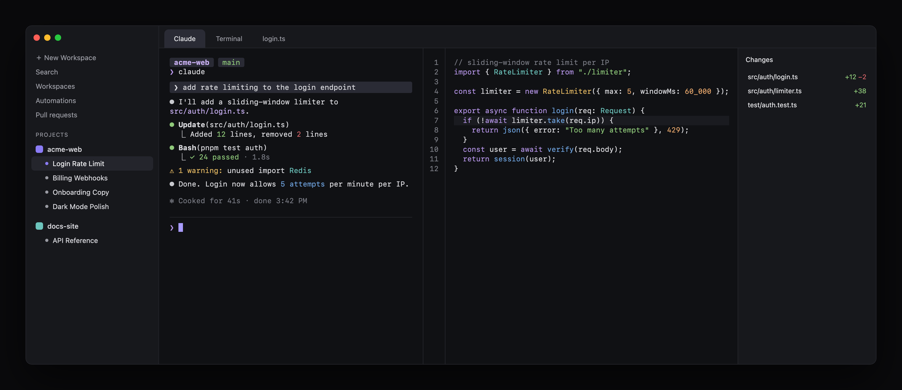

# Hakan: a Paradev (Superset) theme

A cool graphite dark theme with a soft violet accent, made for long coding-agent sessions in [Paradev](https://paradev.com) (formerly Superset). Inspired by the Ghostty / Superlogical Rex look.

- Calm, near-black graphite: the terminal and editor are the darkest areas, the sidebar and panels sit one step lighter
- Soft violet accent (`#8b7cf6`) for the cursor, selection, focus rings and the active workspace
- Low-glare 16-color terminal palette; every text color meets WCAG AA (4.5:1) on its background
- Matching editor, syntax and diff colors

Preview rendered from the theme's own colors.

## Install

1. Download [`hakan.json`](hakan.json).
2. In Paradev, open **Settings → Appearance → Theme → Import** and pick the file.
3. Choose **Hakan** in the theme picker.

## Pairs well with

- Terminal font: SF Mono, Geist Mono or Commit Mono (Nerd Font versions for prompt icons), size 13.5, line height 1.25
- Claude Code: `/theme` → **Dark mode (ANSI colors only)**, so agent output uses this palette

## License

MIT
